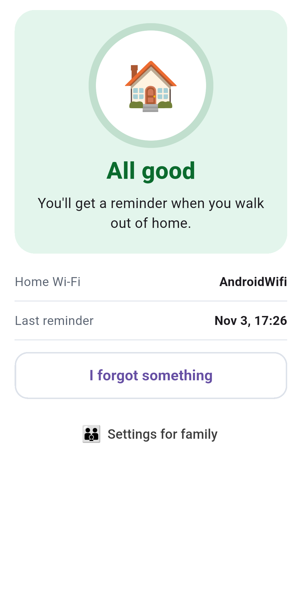
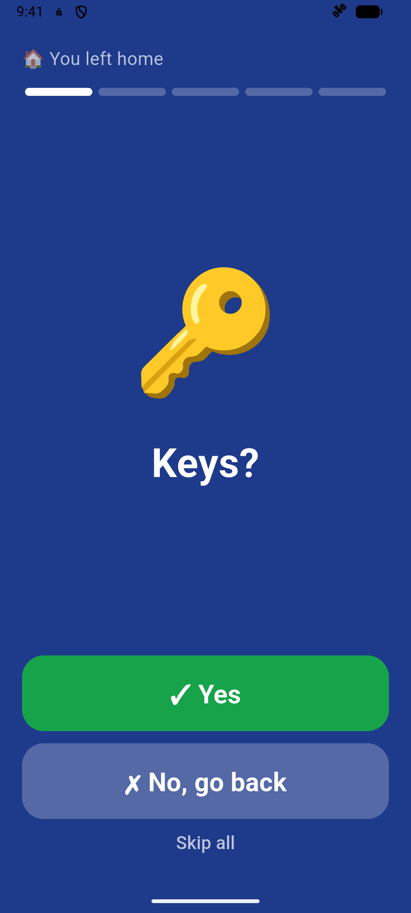
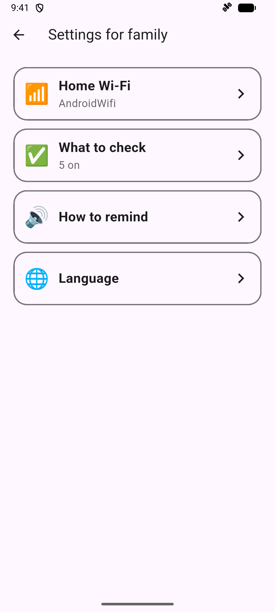
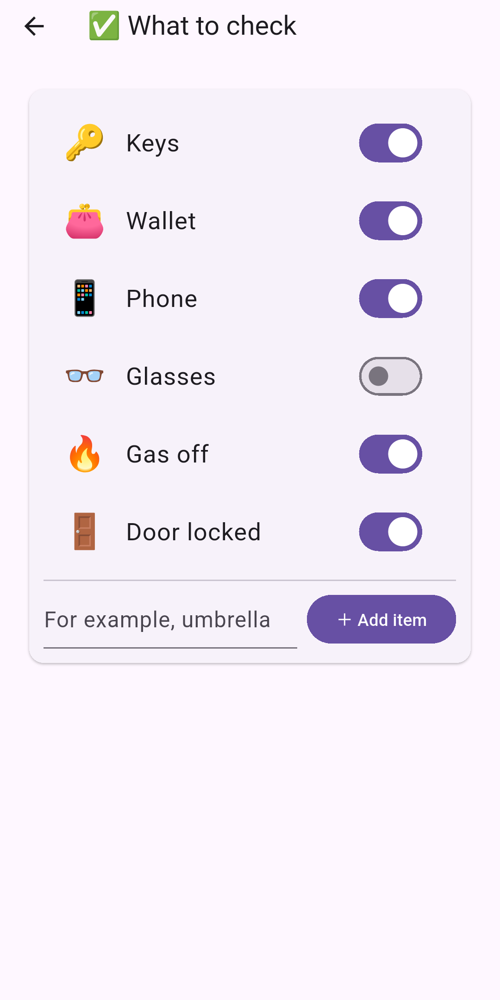

# LeaveCheck

A phone app that reminds elderly people to check their belongings, such as keys, the gas and the door, when they leave home. It runs on Android, in Russian and English, and is still in testing. The home Wi-Fi Reminder is built and works on the emulator, but it hasn't yet been tested on real departures.

| Main screen | Check after leaving | Family settings | What to check |
|---|---|---|---|
|  |  |  |  |

## How it works

A Helper, usually a family member, sets the app up once on the Wearer's phone:

1. Grants the permissions in setup. Location must be "Allow all the time".
2. At home, with the phone on the home Wi-Fi, marks it as the home Wi-Fi.
3. Chooses what to check: keys, wallet, phone, glasses, gas off, door locked, or their own items.

After that the Wearer presses nothing. A Reminder comes when the phone has been on the home Wi-Fi for at least a minute, then loses it, and either:

- walking was noticed from 30 seconds before to 2 minutes after, or
- an accurate location reading is more than 75 m from home.

A router restart while nobody walks gives no Reminder. Tapping the Reminder asks one item at a time ("Keys?" – Yes / No, go back). Yes to the last item stops it; "No, go back" stops it and shows home on the map. Reconnecting to the home Wi-Fi also stops the repeats.

The Helper opens **Settings for family** from the main screen: Home Wi-Fi, What to check, How to remind (tone or recorded voice) and Language. The language follows the phone until the Helper chooses one.

## Build

```bash
flutter pub get
flutter run --dart-define-from-file=.env
flutter test
flutter analyze
```

`.env` holds build-time feature flags. `HOME_WIFI_ONLY=true`, which is also the default without the file, runs only the home Wi-Fi Reminder. With `false`, the earlier features come back: Reminders after a Stay or a Ride, Quiet Places, Reminder Places and the advanced detection settings. Their code and tests are kept.

## More

- Requirements, architecture and design: `docs/requirements.md`, `docs/architecture.md`, `docs/design.md`
- Decisions and why: `docs/decision-log.md`
- Store texts and screenshots: `fastlane/metadata/android/`
- Privacy policy: `docs/privacy-policy.html`; Play Console notes: `docs/store/`
- Probes used to test ideas on real phones: `probes/`

## License

LeaveCheck is **source-available**, not open source. You are welcome to read the code, build it for
yourself and send pull requests. Publishing the app, or anything derived from it, on Google Play or
anywhere else requires my written permission, and anything published with that permission must
stay open: full source under the same licence, with credit and marked changes. See
[LICENSE](LICENSE) for the exact terms.
