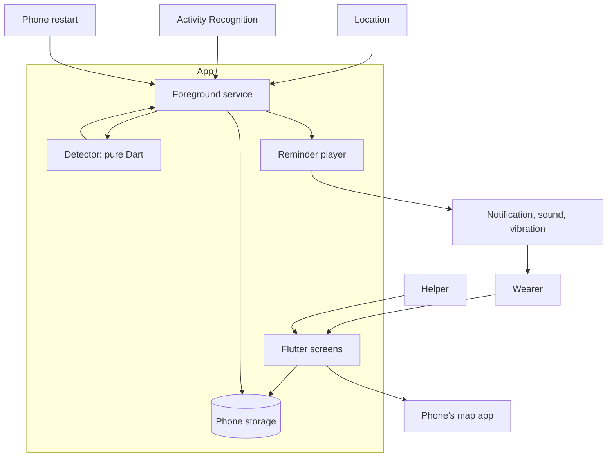

# Geo Alert: Architecture

The design for `docs/requirements.md`, using the terms in `GLOSSARY.md`. Platform behaviour described here is expected, not yet verified on real phones. S1 and S2 exist to check it, and their results may change this document.

## Context



No server exists. Location leaves the phone only when the Wearer opens the map app.

## Folder layout

```text
lib/
  domain/       Pure Dart: Detector, events, decisions, Stay, Ride, Quiet Place, Last Place
  ports/        Interfaces the app needs from the outside world
  adapters/     Thin plugin wrappers, one per port
  service/      Foreground service entry point: connects adapters to the Detector
  ui/           Wearer screen, Helper settings, setup
  l10n/         Russian text, ready to translate
probes/         Throwaway S1 and S2 apps, never imported by lib/
test/
  domain/       Detector tests
  fixtures/     Recorded movement data for replay
```

Dependencies point inward: `ui`, `service` and `adapters` may use `domain` and `ports`. `domain` imports only Dart itself, which a test can enforce by scanning its imports.

## Detector

The Detector is one state machine: `step(state, event) → (newState, decisions)`. It has no clock, plugin or storage access, so recorded movement can be replayed in a test.

| Events in | Meaning |
|---|---|
| `LocationFix(time, lat, lng, accuracy)` | A position reading |
| `ActivityChanged(time, kind, confidence)` | Still, walking, in vehicle, or unknown |
| `Tick(time)` | Time passing with no other signal |
| `QuietPlacesChanged(places)` | The Helper changed the list |
| `SettingsChanged(stayMinutes, stayMeters)` | The Helper changed the Stay setting |

| Decisions out | Meaning |
|---|---|
| `StartReminder(source, lastPlace)` | A Stay or Ride ended |
| `StopRepeats` | The Wearer came back to where the Stay ended |
| `SetLocationMode(off / precise)` | Wake or rest the location signal |

| State | Moves on when |
|---|---|
| `Roaming` | Remained in the Stay area for the Stay time → `InStay`; riding detected → `OnRide` |
| `InStay` | Moved out of the Stay area → `Roaming`, with a Reminder unless at a Quiet Place |
| `OnRide` | Walking confirmed → `Roaming`, with a Reminder |

### Invariants

1. Each ended Stay or Ride produces at most one `StartReminder`.
2. A Stay at a Quiet Place never produces a `StartReminder`.
3. A location reading too inaccurate to trust never ends a Stay.
4. A stop or walking along the vehicle during a Ride does not end it. Walking must last long enough to confirm the Wearer got off, and how long is set from S1's data.
5. A Ride that starts from `InStay` first ends that Stay, with its usual Reminder rule.
6. Detector state is saved after every step that changes it, so a process restart continues the Stay in progress.

## Ports

| Port | Provides | Adapter |
|---|---|---|
| `LocationSource` | Position stream, one-off fix, mode switch | geolocator |
| `ActivitySource` | Activity changes | Activity Recognition plugin, to be chosen in S1 |
| `ReminderPlayer` | Start, repeat, stop; sound, vibration, voice; silent behaviour | flutter_local_notifications plus an audio plugin |
| `Recorder` | Record and play back the Helper's voice | To be chosen in S2 |
| `Store` | Settings, Quiet Places, Last Places, Detector state | shared_preferences |
| `MapLauncher` | Open a location in the map app | url_launcher |
| `HealthCheck` | Location on, permissions, battery optimisation, battery level | geolocator, permission_handler, battery plugin |
| `BackgroundHost` | Start and restart the foreground service | flutter_foreground_task |

The service and screens run in separate isolates, so they share data through `Store` and the service's message channel.

## Errors

| Situation | What happens | Covers |
|---|---|---|
| Location off or permission removed | "Not protecting you, tap to fix" | AC-8.2 |
| No fix when marking a Quiet Place | Nothing saved; a message says why | AC-6.4 |
| Chosen sound or recording won't play | Default Reminder plays | AC-4.4 |
| No map app | Message, plus time and coordinates | AC-5.4 |
| Activity service unavailable, such as no Google Play services | Stay detection continues; Helper is told at setup that train Reminders are unavailable or weaker | D3 |
| Saved state unreadable | Reset Detector to `Roaming` and keep watching; keep settings if readable | Invariant 6 |
| Service stopped unexpectedly | Warning when next detectable | AC-8.2 |

## Key decisions

- **Background:** Dart inside an Android foreground service. Native Kotlin is the fallback if S1 or S5 shows this is unreliable.
- **Silent mode:** the Helper chooses "play aloud" (default) or "vibrate only". "Play aloud" uses the alarm sound channel. Setup must describe what S2 actually finds, including Do Not Disturb.
- **Ride detection:** Activity Recognition first, with GPS speed as a check. Phones without Google Play services may get no Ride detection.
- **Reminder surface:** a high-priority notification with action buttons. No full-screen alert, because Google limits that permission.
- **Storage:** shared_preferences, with no database.
- **minSdk:** raise from 21 to about 26 if plugins require it; confirm in S0.

## Early risk to check

Google Play requires a declaration and review for always-on background location. Check this before S3, because a rejection would threaten the Android-first plan.

## Vertical slices

Each slice can be delivered and tested alone. **Gate** means the result can change the plan.

| Slice | Delivers | Maps to | Done when |
|---|---|---|---|
| **S0** | Flutter project, folder layout, import rule test, profile commands and layout filled in, Google Play policy check | Engineering rules | Test, lint and analyze commands run clean |
| **S1 (Gate)** | `probes/ride`: logs activity, speed and location to a file during real journeys, saved as test data | Early FT-2 | 10 logged rides show whether getting off can be detected within 60 seconds, by train type. Failure removes Ride detection from v1 (US-2, S4) |
| **S2 (Gate)** | `probes/sound`: on a locked phone, plays recorded voice and alarm-channel sound on silent and Do Not Disturb, on at least two phone brands | Early FT-5, AC-3.5, AC-4.2 | Results recorded and silent behaviour confirmed. Voice failure moves it to the first update |
| **S3** | Detector: Stay rules and Quiet Place rule, with replay tests | AC-1.1 to AC-1.5, AC-6.2, AC-6.3 logic | Tests pass with no phone |
| **S4** | Detector: Ride rules, replaying S1's data | AC-2.1 to AC-2.3 | Tests pass on real recorded rides |
| **S5** | Foreground service, saved state, restart after reboot, wake on movement, basic Reminder, "Protecting you" status | AC-8.1, AC-8.4, AC-9.1, FT-1, FT-3 | First real walk gives a notification; FT-1 and FT-3 recorded |
| **S6** | Full Reminder: repeats, two actions, locked phone, silent choice, default and fallback sound | AC-3.1 to AC-3.5, AC-4.3, AC-4.4, FT-2 | FT-2 recorded on the real app |
| **S7** | Last Place: storage, time, open in map app | AC-5.1 to AC-5.6 | Tapping "I forgot something" opens the right place |
| **S8** | Quiet Places: mark and remove | AC-1.3, AC-6.1 to AC-6.4 | Leaving a marked place gives no Reminder |
| **S9** | Reminder customization: sound, vibration, text, recorded voice, test button | AC-4.1, AC-4.2, AC-4.5, FT-5 | FT-5 recorded on the real app |
| **S10** | Guided setup and protected settings | AC-7.1 to AC-7.5 | A fresh install reaches "Protecting you" |
| **S11** | "Not protecting you" warnings | AC-8.2, AC-8.3 | Turning off location warns; fixing it clears the warning |
| **S12** | Should items: low battery warning, Stay setting, two Last Places | AC-9.2, AC-10.1, AC-10.2 | Tests and a manual check pass |
| **S13** | Could items: adjustable repeats, spoken text | Scope "Could" | Build only if still wanted after field results |

FT-4 (full days) runs at `/qa`, once all Must items are in.
