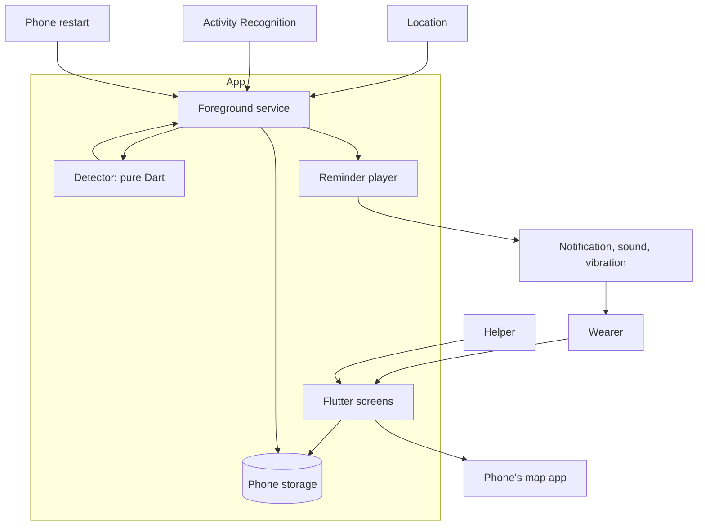
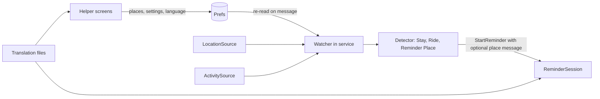

# Geo Alert: Architecture

The design for `docs/requirements.md`, using the terms in `GLOSSARY.md`. Platform behaviour described here is expected, not yet verified on real phones. S1 and S2 exist to check it, and their results may change this document.

## Context



No server exists. Location leaves the phone only when the Wearer opens the map app.

## Folder layout

```text
lib/
  domain/       Pure Dart: Detector, events, decisions, Stay, Ride, Quiet Place, Last Place
  ports/        Interfaces the app needs from the outside world
  adapters/     Thin plugin wrappers, one per port
  service/      Foreground service entry point: connects adapters to the Detector
  ui/           Wearer screen, Helper settings, setup
  l10n/         Russian text, ready to translate
probes/         Throwaway S1 and S2 apps, never imported by lib/
test/
  domain/       Detector tests
  fixtures/     Recorded movement data for replay
```

Dependencies point inward: `ui`, `service` and `adapters` may use `domain` and `ports`. `domain` imports only Dart itself, which a test can enforce by scanning its imports.

## Detector

The Detector is one state machine: `step(state, event) → (newState, decisions)`. It has no clock, plugin or storage access, so recorded movement can be replayed in a test.

| Events in | Meaning |
|---|---|
| `LocationFix(time, lat, lng, accuracy)` | A position reading |
| `ActivityChanged(time, kind, confidence)` | Still, walking, in vehicle, or unknown |
| `Tick(time)` | Time passing with no other signal |
| `QuietPlacesChanged(places)` | The Helper changed the list |
| `SettingsChanged(stayMinutes, stayMeters)` | The Helper changed the Stay setting |

| Decisions out | Meaning |
|---|---|
| `StartReminder(source, lastPlace)` | A Stay or Ride ended |
| `StopRepeats` | The Wearer came back to where the Stay ended |
| `SetLocationMode(lowPower / precise)` | Rest location during a Stay, or wake it when a reading looks outside the area |

| State | Moves on when |
|---|---|
| `Roaming` | Remained in the Stay area for the Stay time → `InStay`; riding detected → `OnRide` |
| `InStay` | Moved out of the Stay area → `Roaming`, with a Reminder unless at a Quiet Place |
| `OnRide` | Walking confirmed → `Roaming`, with a Reminder |

### Invariants

1. Each ended Stay or Ride produces at most one `StartReminder`.
2. A Stay at a Quiet Place never produces a `StartReminder`.
3. A location reading too inaccurate to trust never ends a Stay.
4. A stop or walking along the vehicle during a Ride does not end it. Walking must last long enough to confirm the Wearer got off, and how long is set from S1's data.
5. A Ride that starts from `InStay` first ends that Stay, with its usual Reminder rule.
6. Detector state is saved after every step that changes it, so a process restart continues the Stay in progress.

## Ports

| Port | Provides | Adapter |
|---|---|---|
| `LocationSource` | Position stream, mode switch | geolocator |
| `CurrentFixSource` | One-off fix for the screens | geolocator |
| `ActivitySource` | Activity changes | activity_recognition_flutter, using the patched copy in `packages/`, called with `runForegroundService: false`, because the service already runs in the location foreground service. The plugin's health-type service and `FOREGROUND_SERVICE_HEALTH` permission are removed from the merged manifest. See S14 |
| `ReminderPlayer` | Start, repeat, stop; sound, vibration, voice; silent behaviour | flutter_local_notifications plus an audio plugin |
| `VoiceRecorder` | Record the Helper's voice; playback goes through the Reminder output | record |
| `Store` | Settings, Quiet Places, Last Places, Detector state | shared_preferences |
| `WatcherLink` | Tell the running service a list changed | flutter_foreground_task |
| `MapLauncher` | Open a location in the map app | url_launcher |
| `HealthCheck` | Location on; location, notification and activity permissions | geolocator, permission_handler |
| `ProtectionNotice` | Show the warning in the persistent notification | flutter_foreground_task |
| `BackgroundHost` | Start and restart the foreground service | flutter_foreground_task |

The service and screens run in separate isolates, so they share data through `Store` and the service's message channel. Only the screens write the Quiet Places list. The service re-reads it when told of a change and whenever it starts, and passes it to the Detector as `QuietPlacesChanged`.

## Errors

| Situation | What happens | Covers |
|---|---|---|
| Location off or permission removed | "Not protecting you, tap to fix" | AC-8.2 |
| No fix when marking a Quiet Place | Nothing saved; a message says why | AC-6.4 |
| Chosen sound or recording won't play | Default Reminder plays | AC-4.4 |
| No map app | Message, plus time and coordinates | AC-5.4 |
| Activity service unavailable, such as no Google Play services | Stay detection continues; Helper is told at setup that train Reminders are unavailable or weaker. Setup must check for Play services itself: the plugin only logs a failed registration, so nothing reaches Dart | D3 |
| Activity stream reports an error | Ignored, as with location errors; Stay detection continues and the Ride's 15-minute limit still applies | S14 |
| Saved state unreadable | Reset Detector to `Roaming` and keep watching; keep settings if readable | Invariant 6 |
| Service stopped unexpectedly | Warning when next detectable | AC-8.2 |

## Key decisions

- **Background:** Dart inside an Android foreground service. Native Kotlin is the fallback if S1 or S5 shows this is unreliable.
- **Silent mode:** the Helper chooses "play aloud" (default) or "vibrate only". "Play aloud" uses the alarm sound channel. Setup must describe what S2 actually finds, including Do Not Disturb.
- **Ride detection:** Activity Recognition first, with GPS speed as a check. Phones without Google Play services may get no Ride detection.
- **Reminder surface:** a high-priority notification with action buttons. No full-screen alert, because Google limits that permission.
- **Storage:** shared_preferences, with no database.
- **minSdk:** raise from 21 to about 26 if plugins require it; confirm in S0.

## Early risk to check

Google Play requires a declaration and review for always-on background location. The S0 reading is in `docs/play-policy-check.md`: approval is not assured, because reminders could be judged as convenience. Test this before S3, because a rejection would threaten the Android-first plan.

## Vertical slices

Each slice can be delivered and tested alone. **Gate** means the result can change the plan.

| Slice | Delivers | Maps to | Done when |
|---|---|---|---|
| **S0** | Flutter project, folder layout, import rule test, profile commands and layout filled in, Google Play policy check | Engineering rules | Test, lint and analyze commands run clean |
| **S1 (Gate)** | `probes/ride`: logs activity, speed and location to a file during real journeys, saved as test data | Early FT-2 | 10 logged rides show whether getting off can be detected within 60 seconds, by train type. Failure removes Ride detection from v1 (US-2, S4) |
| **S2 (Gate)** | `probes/sound`: on a locked phone, plays recorded voice and alarm-channel sound on silent and Do Not Disturb, on at least two phone brands | Early FT-5, AC-3.5, AC-4.2 | Results recorded and silent behaviour confirmed. Voice failure moves it to the first update |
| **S3** | Detector: Stay rules and Quiet Place rule, with replay tests | AC-1.1 to AC-1.5, AC-6.2, AC-6.3 logic | Tests pass with no phone |
| **S4** | Detector: Ride rules, replaying S1's data | AC-2.1 to AC-2.3 | Tests pass on real recorded rides |
| **S5** | Foreground service, saved state, restart after reboot, wake on movement, basic Reminder, "Protecting you" status | AC-8.1, AC-8.4, AC-9.1, FT-1, FT-3 | First real walk gives a notification; FT-1 and FT-3 recorded |
| **S6** | Full Reminder: repeats, two actions, locked phone, silent choice, default and fallback sound | AC-3.1 to AC-3.5, AC-4.3, AC-4.4, FT-2 | FT-2 recorded on the real app |
| **S7** | Last Place: storage, time, open in map app | AC-5.1 to AC-5.6 | Tapping "I forgot something" opens the right place |
| **S8** | Quiet Places: mark and remove | AC-1.3, AC-6.1 to AC-6.4 | Leaving a marked place gives no Reminder |
| **S9** | Reminder customization: sound, vibration, text, recorded voice, test button | AC-4.1, AC-4.2, AC-4.5, FT-5 | FT-5 recorded on the real app |
| **S10** | Guided setup and protected settings | AC-7.1 to AC-7.5 | A fresh install reaches "Protecting you" |
| **S11** | "Not protecting you" warnings | AC-8.2, AC-8.3 | Turning off location warns; fixing it clears the warning |
| **S12** | Should items: low battery warning, Stay setting, two Last Places | AC-9.2, AC-10.1, AC-10.2 | Tests and a manual check pass |
| **S13** | Could items: adjustable repeats, spoken text | Scope "Could" | Build only if still wanted after field results |
| **S14** | `ActivitySource` adapter and service wiring, so the Ride rules receive real activity signals. Build next: it doesn't depend on S13 | AC-2.1 to AC-2.3 on the phone, AC-7.2, D3 error row | Tests pass; the release manifest has no health service or permission; on one real ride with the phone locked, getting off gives a Reminder |

FT-4 (full days) runs at `/qa`, once all Must items are in.

### S14 scope

**No S1 results exist yet.** S14 needs no measured numbers, so it goes ahead without them. The Ride values stay the placeholders from S4, and these remain open:

- S1's 10 logged rides, which retune those values using `probes/ride`. The main app must not log rides, because location history is out of scope for v1.
- S4's "tests pass on real recorded rides".
- FT-2, which decides whether Ride stays in v1. S14 passing doesn't settle it, and setup still makes no train or bus claim.

S1 also ran the plugin in the probe's main isolate with no service of its own, so it can't show that signals reach the service isolate. S14's real ride checks that.

**Build:**

1. **Port:** `ActivitySource` in `lib/ports/ports.dart`, with `Stream<ActivityChanged> get changes`.
2. **Adapter:** `lib/adapters/plugin_activity.dart`, with the plugin in `pubspec.yaml`. It passes confidence through, uses the plugin's timestamp, and maps kinds as the replay test does:

   | Plugin type | `ActivityKind` |
   |---|---|
   | `IN_VEHICLE` | `inVehicle` |
   | `WALKING`, `ON_FOOT`, `RUNNING` | `walking` |
   | `STILL` | `still` |
   | `ON_BICYCLE`, `TILTING`, `UNKNOWN` | `unknown` |

3. **Watcher:** takes `ActivitySource`, subscribes in `start()` and cancels in `stop()`. Events go through `handle`, so they run in turn with location readings, and stream errors are ignored.
4. **Entry point:** `lib/service/entry_point.dart` passes the adapter to the Watcher.
5. **Manifest:** `tools:node="remove"` for the plugin's service and `FOREGROUND_SERVICE_HEALTH`.
6. **Setup:** a Play services check. If they are missing, setup tells the Helper that train and bus Reminders won't work on this phone, then continues.

**Tests:** kind mapping; Watcher sends activity to the Detector in order, keeps watching after a stream error, and cancels on stop; setup shows the note; a saved `OnRide` continues after a restart with signals arriving.

**Unchanged:** the Detector and its thresholds. Losing the activity permission gives a warning, which replaces the S11 decision.

## Release additions: US-11 to US-15

The name LeaveCheck applies from S20. Until then, code and earlier sections keep Geo Alert.



### Folder additions

```text
lib/domain/reminder_place_record.dart   name, message, point; encoding
lib/domain/detection_settings.dart      preset or custom values, limits, validation
lib/adapters/prefs_reminder_places.dart
lib/adapters/prefs_detection_settings.dart
lib/adapters/prefs_language.dart
lib/l10n/app_ru.arb, app_en.arb         replace lib/l10n/strings.dart
lib/ui/reminder_places_screen.dart
lib/ui/advanced_settings_screen.dart
lib/ui/language_screen.dart
probes/steps/                           experiment only
```

### Invariants

- A place is never both a Quiet Place and a Reminder Place. Both screens enforce this, and if stored data ever disagrees, Quiet Place wins, because it is the Helper's explicit "stay silent".
- Leaving a Reminder Place gives a Reminder only after at least 1 minute inside its 75 m area, confirmed by the same number of outside readings as a Stay.
- One departure gives one Reminder. If a Stay ends at a Reminder Place, the one Reminder uses that place's message.
- Being near a Reminder Place doesn't stop or reset Stay and Ride detection. During a Ride, Reminder Places are ignored, so passing one in a vehicle gives no Reminder.
- Detection values are always within limits: anything invalid when read falls back to Normal.
- The Ride time limit is not a setting.
- `lib/domain` stays free of Flutter, plugins and translated text. It carries only a place's own message.

### Ports and events

| Item | Change |
|---|---|
| `ReminderPlaceStore` | New: `read()`, `write(list)`; screens write, service reads |
| `DetectionSettingsStore` | Replaces `StayChoiceStore`: `read()`, `write(settings)`. An existing `stay_choice` is read once as its preset |
| `LanguageStore` | New: `read()` returning a language or null, `write(language)` |
| `ReminderPlacesChanged` | New Detector event, sent like `QuietPlacesChanged` |
| `SettingsChanged` | Carries `DetectionSettings`: Stay time and area, vehicle speed, walking time after a Ride |
| `StartReminder` | Adds an optional `placeMessage`. `ReminderSource` gains `reminderPlace` |
| Service messages | Add `reminderPlacesMessage` and `languageMessage` beside the existing ones |

Saved `DetectorState` must still load when these fields are missing, so an update doesn't lose an active Stay.

### Errors

| Case | Behaviour |
|---|---|
| No fix when marking a Reminder Place | Nothing saved; a clear message (AC-11.6) |
| Place already a Quiet Place, or the reverse | Ask which to keep (AC-11.4) |
| Value outside limits | Not saved; limits shown (AC-12.2) |
| Risky value | Warn, then allow saving (AC-12.3) |
| Unreadable places, settings or language in storage | Treat as none, Normal, or the phone's language; keep watching |
| Other phone language | English (AC-13.2) |

### Key decisions

- **Reminder Places:** in the Detector. See `docs/adr/0001-reminder-places-in-detector.md`.
- **Text:** Flutter's standard translation files, looked up without screen context in the service, which reads the saved language.
- **App ID:** becomes `com.leavecheck.app` only after the trademark search passes (S20).

### Slices

| Slice | Delivers | AC | Done when |
|---|---|---|---|
| S15 | **Gate:** real-phone Walk test, then fix location starting if needed | Blocking gap 0, FT-1 start | A real walk gives a Reminder, or the `LocationManager` fallback is built and does. Nothing below ships before this |
| S16 | Translation files, moving all text, language choice, service using the saved language | 13.1 to 13.4 | Tests pass in both languages; no Russian left in code; changing language reaches the next Reminder on the emulator |
| S17 | `DetectionSettings` in the Detector, replacing fixed values; old choice migrated | 10.1, 10.2, 12.5 (values) | Existing tests and replays pass unchanged at recommended values; custom values change outcomes in tests |
| S18 | Advanced settings screen | 12.1 to 12.6 | Widget tests cover limits, warning, reset and protection |
| S19a | Reminder Place rules in the Detector | 11.2, 11.3, 11.5, 11.8 | Replay tests cover visit, walk past, Stay at a place and passing in a vehicle |
| S19b | Reminder Places screen and storage, with the place's message in the Reminder | 11.1, 11.4, 11.6, 11.7 | Widget and Watcher tests pass; FT-6 runnable |
| S20 | Rename to LeaveCheck, new app ID, logo and app icon | 15.1 | Trademark search recorded in `docs/decision-log.md`; clean release build installs under the new ID |
| S21 | Step experiment probe | 14.1 to 14.3 | Real-walk results in `docs/qa-report.md`, with a keep-or-drop decision |
| S22 | Store listing, background location declaration, native-speaker check, release signing | 13.5, 15.2 to 15.4 | Listing text matches FT-2 results; signed build ready for the closed test |

S16 comes first because later screens would otherwise add more text to move. S19b's UI depends on `/designer`, as do S18 and the language screen. FT-1 to FT-6 run on the near-final build, before S22. S21 can run at any time after S15, and doesn't block release: if it isn't finished, steps stay out.
